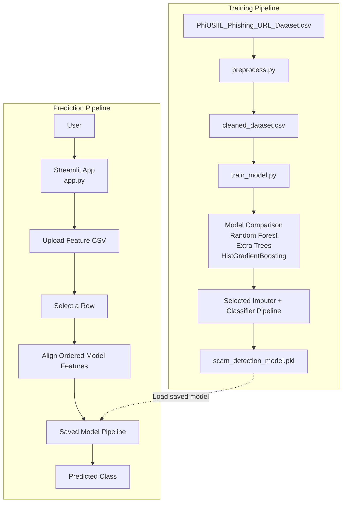
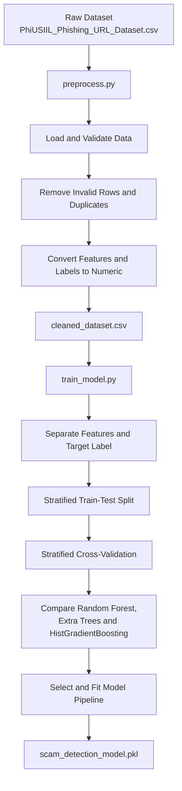
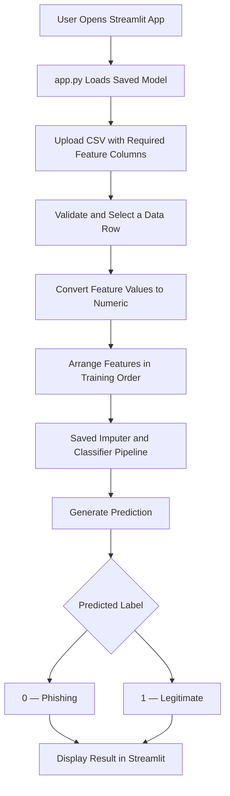

# Scam-Detection-Using-URL
# 🛡️ Phishing URL Detection System

### Machine Learning-Based Scam and Phishing Detection

A machine learning project that trains and evaluates classification models on the **PhiUSIIL Phishing URL Dataset** to distinguish phishing URLs from legitimate URLs using precomputed numerical features.

The project provides an end-to-end machine learning pipeline for data preprocessing, model training, model selection, and interactive predictions through a Streamlit web application.

---

## 📌 Project Overview

Phishing attacks use deceptive websites and URLs to trick users into revealing sensitive information, such as passwords, financial details, and personal data.

This project uses machine learning to classify website records based on their extracted numerical features. It compares multiple classification algorithms and saves the selected model pipeline for use in a Streamlit application.

### Key Features

* 📂 **Dataset Preprocessing:** Loads, validates, cleans, and transforms the dataset.
* 🧹 **Data Cleaning:** Removes invalid rows and duplicate records.
* 🔢 **Feature Processing:** Converts feature values and labels into numeric representations.
* 🤖 **Model Comparison:** Evaluates Random Forest, Extra Trees, and HistGradientBoosting classifiers.
* 📊 **Model Evaluation:** Uses stratified train-test splitting and stratified cross-validation.
* 💾 **Model Persistence:** Saves the fitted preprocessing and classification pipeline.
* 🌐 **Interactive Web App:** Uses Streamlit to upload a CSV, select a row, and display its prediction.
* 🔍 **Phishing Classification:** Predicts whether a record represents phishing or a legitimate website.

---

## 🏗️ System Architecture

The project consists of two primary workflows:

1. **Training Pipeline:** Prepares the dataset, compares machine learning models, and saves the selected model.
2. **Prediction Pipeline:** Loads the saved model, accepts precomputed feature data, and predicts the selected record's class.

### Overall System Architecture



---

## 🔄 1. Training Pipeline

The training pipeline transforms the raw dataset into a trained machine learning model.

### Training Workflow



### Step 1: Dataset

The training process starts with:

`PhiUSIIL_Phishing_URL_Dataset.csv`

This dataset provides the records used to train and evaluate the phishing classification model.

### Step 2: Data Preprocessing — `preprocess.py`

The preprocessing script prepares the raw dataset for machine learning.

Its responsibilities include:

* Loading the original CSV file.
* Validating the dataset structure.
* Removing invalid rows and duplicate records.
* Converting feature values into numeric formats.
* Converting classification labels into numeric values.
* Saving the cleaned dataset.

**Output file:**

`cleaned_dataset.csv`

### Step 3: Model Training — `train_model.py`

The training script loads the cleaned dataset and prepares the data for model development.

Its responsibilities include:

* Separating input features from the target label.
* Creating a stratified training and testing split.
* Comparing multiple machine learning classifiers.
* Evaluating models through stratified cross-validation.
* Selecting and fitting the model pipeline.
* Saving the fitted pipeline and ordered feature names.

### Step 4: Model Comparison

The project compares three machine learning algorithms.

| Algorithm            | Description                                                               |
| -------------------- | ------------------------------------------------------------------------- |
| Random Forest        | Combines multiple decision trees to improve classification robustness.    |
| Extra Trees          | Uses randomized decision trees to capture complex feature relationships.  |
| HistGradientBoosting | Uses histogram-based gradient boosting for efficient tree-based learning. |

The best model is selected according to the evaluation criteria configured in `train_model.py`.

No particular model is guaranteed to perform best on every dataset or split.

### Step 5: Saved Model

The selected fitted pipeline is saved as:

`scam_detection_model.pkl`

The saved artifact contains the fitted imputer and classifier pipeline, together with the ordered feature names needed for prediction.

The imputer handles missing feature values according to its configured strategy.

---

## 🔮 2. Prediction Pipeline

The prediction pipeline uses the trained model to classify records through a Streamlit web application.

### Prediction Workflow



### How Prediction Works

1. The user opens the Streamlit application.
2. The application loads `scam_detection_model.pkl`.
3. The user uploads a CSV containing the required model input features.
4. The user selects a row from the uploaded dataset.
5. The application converts the selected feature values into numeric values.
6. The features are arranged in the order expected by the trained model.
7. The saved imputer and classifier pipeline process the selected record.
8. The application displays the predicted class.

### Prediction Labels

| Label | Meaning    |
| ----- | ---------- |
| `0`   | Phishing   |
| `1`   | Legitimate |

The application uses the target-label mapping defined by this project.

---

## ⚠️ Important Limitation

**This application does not currently extract features directly from a URL.**

The prediction system operates on precomputed numerical features, not on a raw URL string alone.

For example, entering a URL such as:

`https://example.com/login`

is not sufficient to obtain a prediction unless the URL has first been processed into the complete set of features expected by the model.

To predict a record, the user must upload a CSV containing the required input feature columns.

### Current Workflow

```text
URL or Website
      |
      v
External Feature Extraction Required
      |
      v
Numerical Feature CSV
      |
      v
Streamlit Application
      |
      v
Trained Model Pipeline
      |
      v
Phishing / Legitimate Prediction
```

The feature extraction step is outside the current application's implemented prediction workflow.

### Future Enhancement

A future version could accept a URL directly and integrate a feature extraction module that computes the same features used during training.

That enhancement would require implementing and validating the feature extraction logic before passing its output to the saved model.

---

## 🧰 Technology Stack

| Technology       | Purpose                                                         |
| ---------------- | --------------------------------------------------------------- |
| Python           | Core programming language                                       |
| Pandas           | Dataset loading, cleaning, and manipulation                     |
| NumPy            | Numerical data processing                                       |
| Scikit-learn     | Preprocessing, model training, cross-validation, and prediction |
| Streamlit        | Interactive web application                                     |
| Joblib or Pickle | Model serialization, depending on the implementation            |
| Git and GitHub   | Version control and project hosting                             |

The exact dependencies should match the imports and serialization method used in your source files.

---

## 📁 Project Structure

The following is a suggested structure based on the described pipeline. Adjust filenames and directories to match your actual repository.

```text
Phishing-URL-Detection/
│
├── README.md
├── requirements.txt
├── .gitignore
│
├── PhiUSIIL_Phishing_URL_Dataset.csv
├── cleaned_dataset.csv
├── scam_detection_model.pkl
│
├── preprocess.py
├── train_model.py
├── run_pipeline.py
├── app.py
│
└── screenshots/
    └── dashboard.png
```

### File Descriptions

| File                                | Purpose                                                             |
| ----------------------------------- | ------------------------------------------------------------------- |
| `preprocess.py`                     | Cleans and prepares the raw dataset.                                |
| `train_model.py`                    | Trains, compares, evaluates, and saves the selected model pipeline. |
| `run_pipeline.py`                   | Runs preprocessing followed by model training.                      |
| `app.py`                            | Launches the Streamlit interface and performs predictions.          |
| `requirements.txt`                  | Lists Python dependencies.                                          |
| `PhiUSIIL_Phishing_URL_Dataset.csv` | Original dataset used for training.                                 |
| `cleaned_dataset.csv`               | Preprocessed dataset generated during training.                     |
| `scam_detection_model.pkl`          | Serialized fitted model pipeline and ordered feature names.         |

**Repository note:** Large datasets and trained model artifacts may be better distributed through an appropriate dataset or artifact repository rather than committed directly to GitHub.

---

## ⚙️ Installation and Setup

### Prerequisites

Install the following:

* Python 3.10 or a compatible version supported by your dependencies.
* pip, the Python package installer.
* Git, if cloning the project from GitHub.

### Step 1: Clone the Repository

```bash
git clone <YOUR_GITHUB_REPOSITORY_URL>
cd <YOUR_PROJECT_DIRECTORY>
```

Replace the placeholders with your repository URL and actual directory name.

### Step 2: Create a Virtual Environment

```bash
python -m venv .venv
```

Activate the environment on Windows:

```powershell
.venv\Scripts\activate
```

Activate the environment on Linux or macOS:

```bash
source .venv/bin/activate
```

### Step 3: Install Dependencies

If your repository contains `requirements.txt`, run:

```bash
pip install -r requirements.txt
```

Otherwise, install the dependencies required by your scripts. A typical starting point is:

```bash
pip install pandas numpy scikit-learn streamlit joblib
```

Install any additional packages imported by your implementation.

### Step 4: Prepare the Dataset

Ensure that the raw dataset is available at the path expected by `preprocess.py`.

Expected filename:

```text
PhiUSIIL_Phishing_URL_Dataset.csv
```

If the dataset is stored elsewhere, update the configured file path in the preprocessing script.

---

## 🚀 Running the Project

### Option 1: Run the Complete Training Pipeline

Run:

```bash
python run_pipeline.py
```

This script runs the preprocessing stage followed by model training.

Expected workflow:

```text
Raw Dataset
    |
    v
preprocess.py
    |
    v
cleaned_dataset.csv
    |
    v
train_model.py
    |
    v
scam_detection_model.pkl
```

After successful execution, verify that the cleaned dataset and trained model artifact were created.

### Option 2: Run Preprocessing and Training Separately

Preprocess the dataset:

```bash
python preprocess.py
```

Train and save the model:

```bash
python train_model.py
```

Use this option when you want to inspect the output of each stage independently.

### Option 3: Launch the Streamlit Application

Once the model artifact exists, run:

```bash
streamlit run app.py
```

Open the local URL printed by Streamlit, usually:

```text
http://localhost:8501
```

Upload a CSV containing the required feature columns, select a row, and view its prediction.

---

## 📊 Model Evaluation

The training pipeline uses stratified data splitting and stratified cross-validation to compare the candidate classifiers.

Useful evaluation metrics for phishing detection include:

* **Accuracy:** Overall proportion of correctly classified records.
* **Precision:** Proportion of predicted phishing records that are actually phishing.
* **Recall:** Proportion of actual phishing records correctly identified.
* **F1-score:** Harmonic mean of precision and recall.
* **Confusion Matrix:** Breakdown of correct and incorrect predictions by class.

Recall and precision are particularly important because false negatives may allow phishing websites to go undetected, while false positives can incorrectly flag legitimate websites.

Report the actual evaluation results produced by your training script. Do not include estimated or fabricated performance percentages.

---

## 🔐 Security and Reliability Considerations

* Treat model predictions as indicators, not guarantees that a website is safe or malicious.
* Keep training and testing data properly separated.
* Use stratified cross-validation when comparing classifiers.
* Ensure that feature columns and their ordering match the training configuration.
* Keep the training and inference preprocessing logic consistent.
* Validate uploaded CSV files before passing their contents to the model.
* Limit upload sizes and handle malformed files safely.
* Only load trusted model artifacts. Serialized Python files can execute code when loaded.
* Avoid claiming that a URL is safe solely because the model predicts `1` (Legitimate).

---

## 🔮 Future Enhancements

Potential improvements include:

* Direct URL input and automated feature extraction.
* A URL feature extraction module consistent with the training dataset.
* Model performance visualizations and a confusion matrix dashboard.
* Explainable predictions using feature importance or SHAP.
* Batch prediction for multiple records.
* Prediction history and downloadable reports.
* Model versioning and reproducible training.
* Monitoring for changes in data distributions and model performance.
* Deployment through a hosted Streamlit application.

These are potential future features and should not be considered implemented unless they are present in the codebase.

---

## 🎯 Project Summary

This project demonstrates a complete machine learning workflow for phishing classification:

1. **Preprocess** the raw PhiUSIIL dataset.
2. **Train and compare** multiple classification algorithms.
3. **Save** the selected fitted pipeline.
4. **Load** the trained model in a Streamlit application.
5. **Predict** whether a selected feature record is phishing or legitimate.

The current system performs predictions using precomputed dataset features. Direct URL-to-feature extraction is a potential future extension.

---

## 📄 License

Add a suitable open-source license if you intend to distribute the project publicly. Make sure the dataset's licensing and usage terms are also respected.

---

**Developed as a machine learning project for phishing URL detection and classification.**
